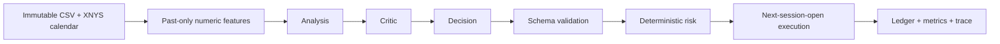

# QuantAgent Lab

**Multi-Agent AI Quantitative Trading Research Platform** · Target: `v0.1.0-alpha`

[繁體中文](README.zh-TW.md) · [Architecture](docs/ARCHITECTURE.md) · [Research methodology](docs/RESEARCH_METHODOLOGY.md) · [Release review](docs/PUBLIC_RELEASE_REVIEW.md)

A local workstation for inspecting multi-agent decisions, deterministic risk checks, backtests and portfolio ledgers. The alpha demonstrates a complete **synthetic-data, Mock/Replay workflow without an API key**.

**Status:** release preparation, not yet published. Mock agents are fixed rules, not live LLM inference. The optional OpenAI adapter has HTTP-fixture coverage but has not been validated through a paid model experiment. No broker integration is present.


## Features

- Six pages: overview, market analysis, Agent Decision Explorer, strategy comparison, runs and settings.
- Buy & Hold, MA20/MA60, Single-Agent and Analysis → Critic → Decision strategies.
- Daily SPY-format bars, weekly close decisions, next-session-open simulated fills.
- MA20/60, Wilder RSI/ATR, volatility, returns and volume features.
- Long-only 0%, 50% or 100% exposure, transaction costs, equity and drawdown charts.
- Agent inputs, raw responses, validation, risk outcomes, trades and JSON exports.
- Offline Replay, budget/call limits, idempotent creation and interrupted-run diagnostics.

## How the agents work



LangGraph runs a fixed sequence. Analysis sees numeric features; Critic also receives validated Analysis; Decision receives features and validated predecessors. Agents propose weights and cannot mutate the ledger. Invalid output, provider failure or exhausted budget skips a decision and keeps the position. An approved zero target deliberately liquidates it.


## Quick start

Requirements: Python 3.13, [uv](https://docs.astral.sh/uv/), Node.js 22 and npm. Run from the repository root after obtaining the approved source snapshot or cloning the published repository.

```sh
uv sync --locked
npm --prefix frontend ci
node tools/dev.mjs
```

Open [the workstation](http://127.0.0.1:3000) or [API documentation](http://127.0.0.1:8000/docs). The launcher binds to loopback. Ctrl+C stops its child processes.

Choose **建立實驗**, keep dataset `synthetic-spy-v1` and mode **Mock**, then create a Multi-Agent run. In **Agent 決策**, select a date to inspect all three roles. In **策略比較**, **執行四組 Mock** creates a comparable set. In **實驗紀錄**, **重播這份實驗** reruns a completed run without a provider call. UI labels are currently Traditional Chinese.

The bundled fixture has 2,011 deterministic synthetic sessions from 2018–2025. It is **not historical SPY pricing**. To reproduce the four-strategy demo while the service is running:

```sh
uv run --no-sync python tools/run_research.py --dataset synthetic-spy-v1 --start 2024-01-01 --end 2024-12-31
```

Generated runs and exports remain local in ignored `artifacts/`. Replay needs no private database: create a Mock run, then replay it.

## Screens and walkthrough


[Watch the short walkthrough](docs/images/walkthrough.webm). All media show synthetic Mock demonstrations, not real-model research results.

## Optional data and models

Real market data is not bundled. For personal research, obtain data under your provider's terms:

```sh
uv sync --locked --group market
uv run --no-sync python tools/fetch_market_data.py
```

The downloader explicitly disables price adjustment and stores immutable CSV/metadata in ignored `data/cache/`. Splits are rejected pending corporate-action support. To import your own canonical raw CSV:

```sh
uv run --no-sync python tools/fetch_market_data.py --csv ./data/cache/input-spy.csv --id spy-local-v1 --source "Your authorized data source"
```

Columns: `session_date,open,high,low,close,volume`; ascending, unique, complete exchange sessions. A provider package's license does not grant redistribution rights to market data.

Mock and Replay require no credentials. API mode requires backend environment variables `OPENAI_API_KEY`, `LLM_MODEL`, `LLM_INPUT_USD_PER_MILLION` and `LLM_OUTPUT_USD_PER_MILLION`. [.env.example](.env.example) documents names only. The app **does not automatically load .env files**; set variables in the backend shell or a private process manager. Never put keys in frontend variables or Git.

Each request has a 1,024-output-token limit and a 30-second timeout; eligible transient failures get at most one retry. Every attempt consumes a call allowance and reserves estimated cost before sending. Unknown billing remains reserved. Estimates do not replace provider invoices. No paid model or price is silently selected.

`QUANTAGENT_DB_PATH` changes the default `artifacts/research.sqlite3`; `BACKEND_URL` changes the Next.js proxy destination. One application process and one background worker own SQLite. Restart marks unfinished runs failed. Stop the service or use SQLite Backup API before copying the database/WAL.

## Verify

```sh
uv run --no-sync pytest -q
python tools/audit_public.py
npm --prefix frontend run typecheck
npm --prefix frontend run build
```

For browser tests, stop the normal dev launcher first: Next dev instances share a directory lock.

```sh
cd frontend
npx playwright install chromium
npm run test:e2e
```

E2E starts isolated services on 8001/3001 with Mock only. GitHub Actions is configured with read-only repository permissions; hosted CI has not yet run. See [verification evidence](docs/VERIFICATION_LOG.md).

`audit_public.py` above expects a Git checkout rooted here. For a pristine source archive without `.git`, use `python tools/audit_public.py --directory <snapshot-directory>` before installing dependencies or generating runtime artifacts. It refuses to silently inherit a parent repository's metadata.

## Limits and licensing

Returns are **price-only**, excluding dividends and cash interest. There is no forced final liquidation. Backtests do not establish future profitability. Hiding dates does not prove a pretrained model never saw historical events; 2025 is a project holdout, not proof of unseen model knowledge. Compare coverage, inference cost and failures alongside returns.

The owner selected [MIT](LICENSE), attributed to QuantAgent Lab contributors. This candidate remains unpublished and requires final publication approval. [License review](docs/LICENSE_PROPOSAL.md). [Third-party notices](THIRD_PARTY_NOTICES.md) apply; TradingView chart attribution is retained.

See [contributing](CONTRIBUTING.md), [security](SECURITY.md), [roadmap](docs/ROADMAP.md) and the [release checklist](docs/PUBLIC_RELEASE_CHECKLIST.md). Public deployment is a separate future task; the alpha has no authentication or anonymous-use paid-model gateway.
