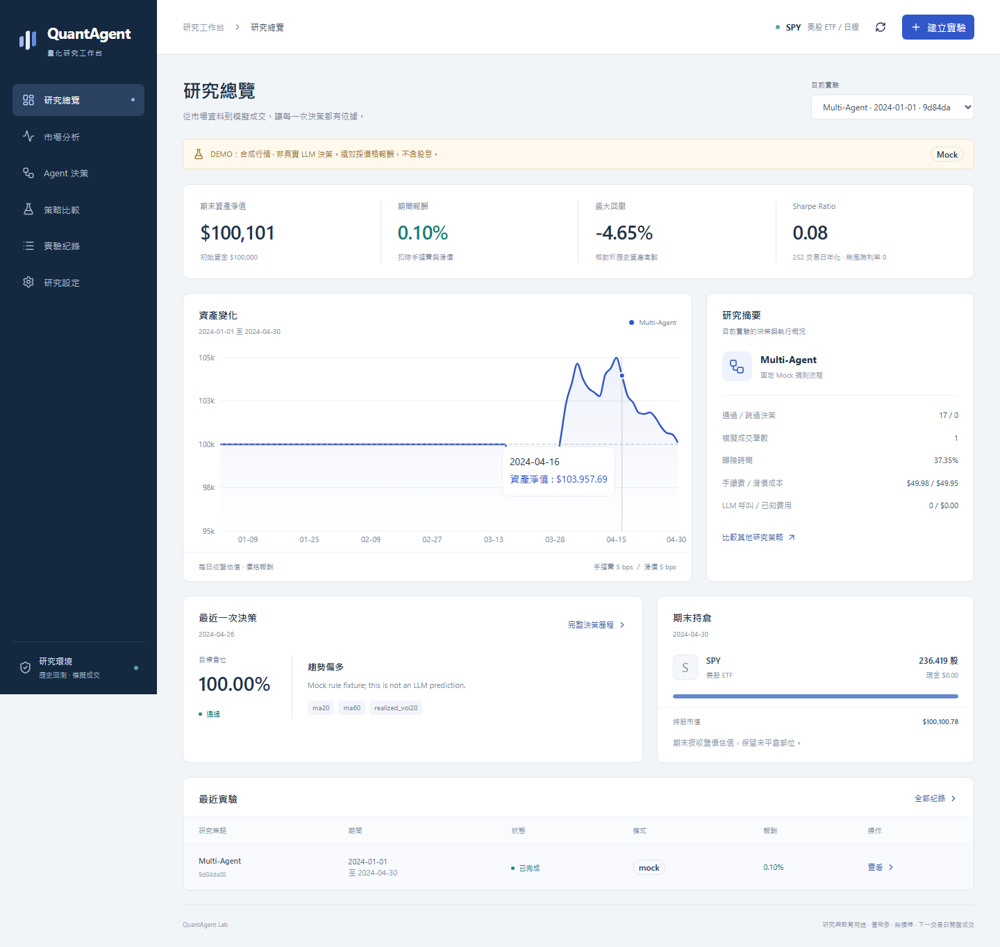
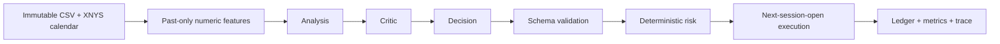
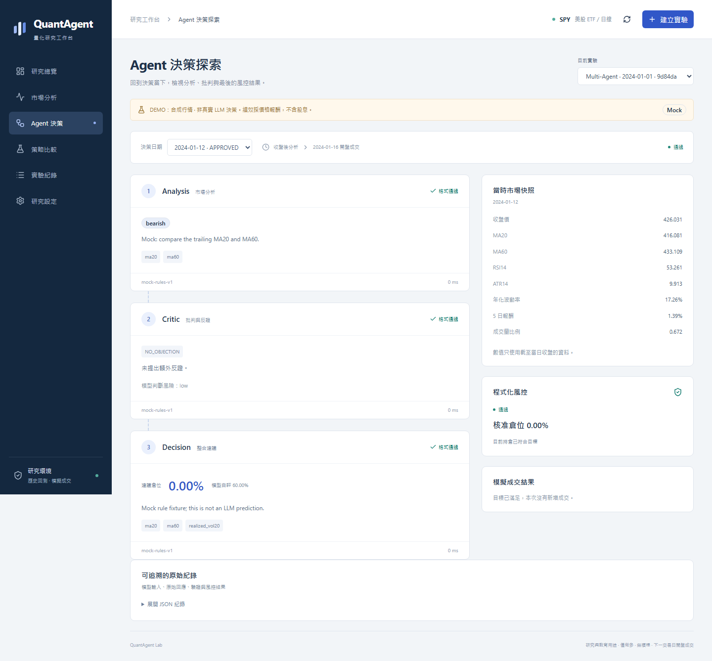
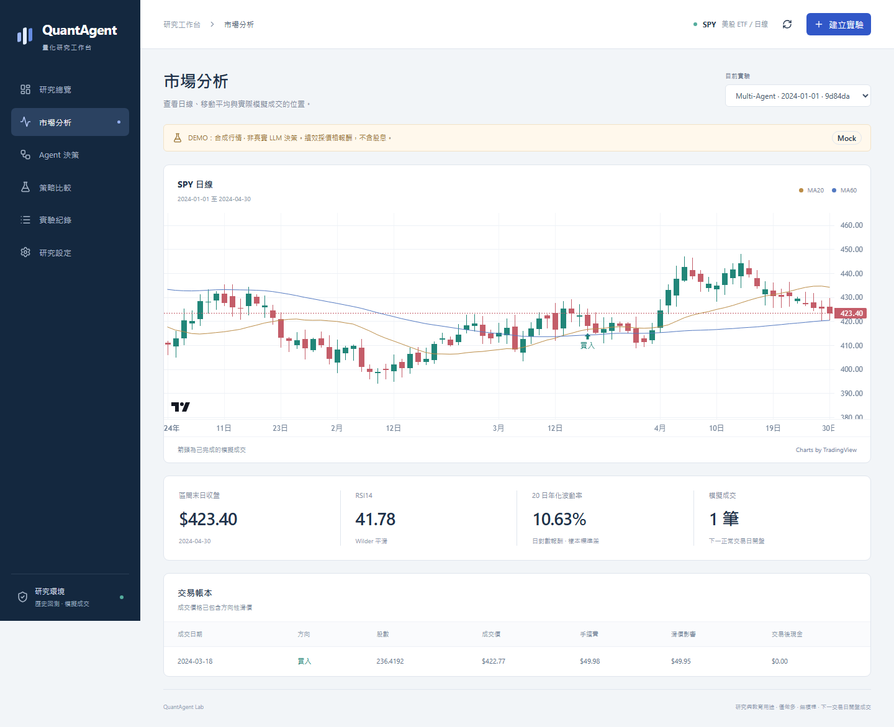
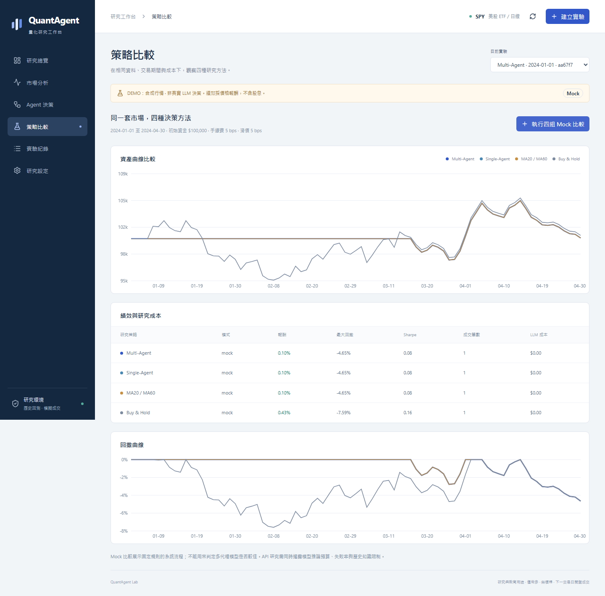

# QuantAgent Lab

**Multi-Agent AI Quantitative Trading Research Platform** · Research alpha software closeout (2026-10-29)

[繁體中文](README.zh-TW.md) · [Architecture](docs/ARCHITECTURE.md) · [Research methodology](docs/RESEARCH_METHODOLOGY.md) · [Release review](docs/PUBLIC_RELEASE_REVIEW.md)

A local workstation for inspecting multi-agent decisions, deterministic risk checks, backtests and portfolio ledgers. The alpha demonstrates a complete **synthetic-data, Mock/Replay workflow without an API key**.

**Status:** the research alpha software scope is closed and the source is already [public](https://github.com/opblackyo/quantagent-lab). The default, supported demonstration uses synthetic data with Mock/Replay and needs no API key. The final closeout's real UI gateway acceptance was **blocked before inference** by unresolved settlement-unit/fee verification; it is not a completed live-model acceptance. Historical private research is separate and does not establish future profitability or product revenue. No broker integration or public application deployment is provided. See [closeout limitations](docs/RESEARCH_CLOSEOUT.md) and the [operator guide](docs/OPERATOR_GUIDE.md).



## Features

- Six pages: overview, market analysis, Agent Decision Explorer, strategy comparison, runs and settings.
- Buy & Hold, MA20/MA60, Single-Agent and Analysis → Critic → Decision strategies.
- Daily SPY-format bars, weekly close decisions, next-session-open simulated fills.
- MA20/60, Wilder RSI/ATR, volatility, returns and volume features.
- Long-only 0%, 50% or 100% exposure, transaction costs, equity and drawdown charts.
- Agent inputs, raw responses, validation, risk outcomes, trades and JSON exports.
- Offline Replay, budget/call limits, idempotent creation and interrupted-run diagnostics.

## How the agents work



LangGraph runs a fixed sequence. Analysis sees numeric features; Critic also receives validated Analysis; Decision receives features and validated predecessors. Agents propose weights and cannot mutate the ledger. Invalid output, provider failure or exhausted budget skips a decision and keeps the position. An approved zero target deliberately liquidates it.



## Quick start

Requirements: Python 3.13, [uv](https://docs.astral.sh/uv/), Node.js 22 and npm. Run from the repository root after obtaining the approved source snapshot or cloning the published repository.

```sh
uv sync --locked
npm --prefix frontend ci
node tools/dev.mjs
```

Open [the workstation](http://127.0.0.1:3000) or [API documentation](http://127.0.0.1:8000/docs). The launcher binds to loopback. Ctrl+C stops its child processes.

If those ports are occupied, leave the other services running and choose free ports explicitly:

```sh
node tools/dev.mjs --backend-port 18411 --frontend-port 13411
```

Open `http://127.0.0.1:13411`. An explicit backend port also updates the frontend proxy. The launcher refuses occupied ports before starting either child; it never stops another service. `node --test tools/dev_options.test.mjs` checks the launcher options.

Choose **建立實驗**, keep dataset `synthetic-spy-v1` and mode **Mock**, then create a Multi-Agent run. In **Agent 決策**, select a date to inspect all three roles. In **策略比較**, **執行四組 Mock** creates a comparable set. In **實驗紀錄**, **重播這份實驗** reruns a completed run without a provider call. UI labels are currently Traditional Chinese.

The bundled fixture has 2,011 deterministic synthetic sessions from 2018–2025. It is **not historical SPY pricing**. To reproduce the four-strategy demo while the service is running:

```sh
uv run --no-sync python tools/run_research.py --dataset synthetic-spy-v1 --start 2024-01-01 --end 2024-12-31
```

When using the alternate backend port above, add `--api http://127.0.0.1:18411/api/v1` to this pipeline command.

Generated runs and exports remain local in ignored `artifacts/`. Replay needs no private database: create a Mock run, then replay it.

Source ZIPs intentionally omit `.git`. Their run exports have no Git commit metadata; use the displayed source hash and the delivery's external file/commit manifest to identify the code. The UI distinguishes unavailable Git metadata from a detected modified checkout.

## Screens and walkthrough





[Watch the short walkthrough](docs/images/walkthrough.webm). All media show synthetic Mock demonstrations, not real-model research results.

## Optional data and models

Real market data is not bundled. For personal research, obtain data under your provider's terms:

```sh
uv sync --locked --group market
uv run --no-sync python tools/fetch_market_data.py
```

The downloader explicitly disables price adjustment and stores immutable CSV/metadata in ignored `data/cache/`. Splits are rejected pending corporate-action support. To import your own canonical raw CSV:

```sh
uv run --no-sync python tools/fetch_market_data.py --csv ./data/cache/input-spy.csv --id spy-local-v1 --source "Your authorized data source"
```

Columns: `session_date,open,high,low,close,volume`; ascending, unique, complete exchange sessions. A provider package's license does not grant redistribution rights to market data.

Mock and Replay require no credentials. API mode requires backend environment variables `OPENAI_API_KEY`, `LLM_MODEL`, `LLM_INPUT_USD_PER_MILLION` and `LLM_OUTPUT_USD_PER_MILLION`. [.env.example](.env.example) documents names only. The app **does not automatically load .env files**; set variables in the backend shell or a private process manager. Never put keys in frontend variables or Git.

The ordinary adapter defaults to 1,024 output tokens and 30 seconds for each HTTPX connect/read/write/pool phase. These are phase/inactivity limits, not a total wall-clock deadline. Private runners can freeze a finite server-side `timeout_policy` separately from the model payload. Timeouts record a sanitized category and elapsed attempt duration and are never automatically retried; eligible HTTP failures may use the configured retry allowance. Every attempt reserves cost before sending. Unknown billing remains reserved; estimates do not replace actual billing evidence.

The ordinary application stays no-key Mock/Replay. Its capabilities advertise only those modes, and its ordinary HTTP launch route rejects paid Agent launches for both direct and gateway providers. The direct/gateway adapter implementations and backend configuration described above do not enable a paid launch from that route; a separate experimental operator entry (`tools/run_live_operator.py`) composes server-held approval bundles, an HTTPS client and lazy private-key loading for a bounded UI path. The shipped real-HTTP settlement path retains its full reservation when independently verified gateway charge evidence is absent; it does not turn token estimates into actual charges. This entry has offline fixture/TLS/timeout coverage, but the final closeout did not complete paid UI acceptance. It is not a ready-to-use live billing integration. An explicit local research fixture can preview, run, and export a four-source study against the synthetic CSV; that fixture is not live provider validation, hosted authentication, or a public release. JSON export is supported. Browser upload/import is not implemented. Provider reliability experiments are separate from the local Mock/Replay demo's completion criteria. No additional feature milestone is opened by this closeout.

`QUANTAGENT_DB_PATH` changes the default `artifacts/research.sqlite3`; `BACKEND_URL` changes the Next.js proxy destination. `QUANTAGENT_LOCAL_ORIGINS` lists the exact loopback browser origins allowed to call this API, for example `http://127.0.0.1:3001`. `tools/dev.mjs` sets that origin from the frontend port it binds. One application process and one background worker own SQLite. Restart marks unfinished runs failed. Stop the service or use SQLite Backup API before copying the database/WAL.

## Verify

```sh
uv run --no-sync pytest -q
python tools/audit_public.py --approved-name opblackyo --approved-noreply 68807943+opblackyo@users.noreply.github.com
npm --prefix frontend run typecheck
npm --prefix frontend run build
```

For browser tests, stop the normal dev launcher first: Next dev instances share a directory lock.

```sh
cd frontend
npx playwright install chromium
npm run test:e2e
```

E2E starts isolated services on 8001/3001 with Mock only. Additional study/operator fixture checks use owned loopback ports and synthetic transports; see the operator guide. GitHub Actions uses read-only repository permissions. Current snapshot checks are recorded in [GitHub Actions](https://github.com/opblackyo/quantagent-lab/actions/workflows/ci.yml); queued work is not a passing result. [Hosted CI for the published initial commit](https://github.com/opblackyo/quantagent-lab/actions/runs/40076415541) passed 48 Python tests, four Chromium E2E tests, typecheck and build; this does not verify later local changes. See [verification evidence](docs/VERIFICATION_LOG.md).

`audit_public.py` above expects a Git checkout rooted here. For a pristine source archive without `.git`, use `python tools/audit_public.py --directory <snapshot-directory>` before installing dependencies or generating runtime artifacts. It refuses to silently inherit a parent repository's metadata.

## Limits and licensing

Returns are **price-only**, excluding dividends and cash interest. There is no forced final liquidation. Backtests do not establish future profitability. Hiding dates does not prove a pretrained model never saw historical events; 2025 is a project holdout, not proof of unseen model knowledge. Compare coverage, inference cost and failures alongside returns.

The owner selected [MIT](LICENSE), attributed to QuantAgent Lab contributors. The initial source snapshot was published with owner approval on 2026-10-24. This closeout publishes only the reviewed source snapshot and synthetic examples. Raw private research and market data remain excluded; their rights and privacy require separate review. [License review](docs/LICENSE_PROPOSAL.md). [Third-party notices](THIRD_PARTY_NOTICES.md) apply; TradingView chart attribution is retained.

See [contributing](CONTRIBUTING.md), [security](SECURITY.md), [roadmap](docs/ROADMAP.md) and the [release checklist](docs/PUBLIC_RELEASE_CHECKLIST.md). Public deployment is a separate future task; the alpha has no authentication or anonymous-use paid-model gateway.

For bounded private research, see [pilot configuration and reproduction](docs/REAL_MODEL_PILOT.md). Each new paid experiment requires its own explicit model, prices, spending authorization and private backend key configuration. Private research status is recorded outside public documentation.
