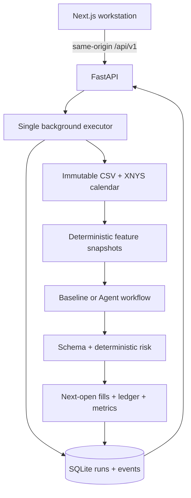

# Architecture

The alpha is one local FastAPI application, one serial research worker, SQLite and a Next.js client. It does not need a distributed agent runtime or broker service.

## Modules

| Path | Responsibility |
| --- | --- |
| `backend/app/data.py` | Dataset registry, content hash, CSV/session validation |
| `features.py` | Past-only indicators and immutable snapshots |
| `agents.py` | Role instructions, schemas, Mock/OpenAI adapters, fixed LangGraph, Replay |
| `backtest.py` | Risk assessment, cost-aware sizing, holdings and metrics |
| `experiments.py` | Common schedule, daily event loop, four strategies and evidence |
| `storage.py` | Exclusive process ownership, serialized SQLite transactions, run/event persistence |
| `main.py` | API, asynchronous creation, idempotency, comparison and exports |
| `frontend/src/components/workstation.tsx` | Six connected views and experiment creation |
| `frontend/src/components/charts.tsx` | Lightweight Charts candles and Recharts analytics |

## Agent contract

Analysis receives numeric features. Critic receives those features plus validated Analysis. Decision receives features and validated predecessors; Single-Agent runs Decision alone. All use the same configured provider/model in API mode. No arbitrary tools, web access, loops or parallel votes are configured.

Pydantic rejects extra fields, invalid evidence names, nonfinite values and invalid weights. Proposed weights pass the deterministic risk engine. An Agent has no ledger/order API. Invalid decisions and provider/budget failures preserve holdings. Mock uses deterministic rules; Replay validates stored outputs and recomputes risk/ledger without provider calls.

## Persistence and API

Creation returns HTTP 202 plus a run ID. A single executor processes jobs. The caller's idempotency key prevents duplicate creation after a lost response. SQLite stores configuration, code/dataset provenance, completed results and per-call/decision/trade/equity events. Input and cost reservation are saved before a possibly billable request. Completed/failed evidence is immutable through the Store API. Restart fails unfinished jobs; diagnostic exports retain interrupted calls.

Representative routes: `/api/v1/datasets`, `/market/bars`, `/system/capabilities`, `/experiments`, `/experiments/compare`, and per-run `/decisions`, `/trades`, `/equity`, `/metrics`, `/events`, `/export`.

The client proxies through Next.js to loopback FastAPI. There is no authentication or public-service isolation. Paid API configuration stays in the backend environment. Public deployment requires separate design and verification; it is not enabled by this release.
